# Orçamento

Documentação detalhada sobre **Orçamento** no módulo de 💰 Cotações.

## Objetivo

A tela de Orçamento é o módulo central para criação e gestão de orçamentos no sistema IARA. Permite buscar produtos, montar o carrinho de compras, configurar dados comerciais e gerar pedidos de venda.

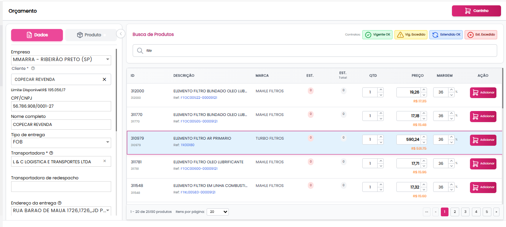

## Acesso à Tela

**Caminho:** Menu lateral → Cotações → Orçamento

A tela exibirá "Orçamento" no topo como identificação.

## Estrutura da Tela

A tela é dividida em três áreas principais:

| Área | Localização | Função |
|------|-------------|--------|
| Painel Lateral (Dados) | Esquerda | Informações do cliente e cabeçalho do orçamento |
| Área Central | Centro | Busca e listagem de produtos |
| Cabeçalho Superior | Topo direito | Ações principais (Compartilhar, Carrinho) |

---

## Painel Lateral - Aba "Dados"

O painel lateral possui duas abas: **Dados** e **Produto**. A aba Dados concentra todas as informações comerciais do orçamento.

### Dados da Empresa/Cliente

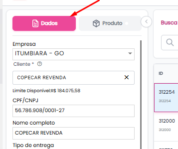

| Campo | Tipo | Descrição |
|-------|------|-----------|
| Empresa | Select | Filial de faturamento (ex: RIBEIRÃO PRETO - SP) |
| CPF/CNPJ | Texto | Documento do cliente  |
| Nome completo | Texto | Razão social ou nome do cliente |

### Dados de Entrega

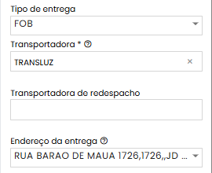

| Campo | Tipo | Obrigatório | Descrição |
|-------|------|-------------|-----------|
| Tipo de entrega | Select | Sim | Modalidade de frete (FOB, CIF, etc.) |
| Transportadora | Select com busca | Sim* | Transportadora principal (campo com "×" para limpar) |
| Transportadora de redespacho | Select com busca | Não | Transportadora secundária para redespacho |
| Endereço da entrega | Select | Sim | Endereço cadastrado do cliente |

### Dados Comerciais

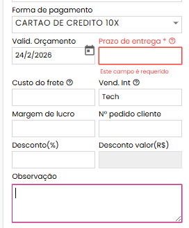

| Campo | Obrigatório | Descrição |
|-------|-------------|-----------|
| Forma de pagamento | Sim | Condição de pagamento (ex: CARTÃO DE CRÉDITO 10X) |
| Valid. Orçamento | Sim | Data de validade do orçamento |
| Prazo de entrega | Sim* | Prazo em dias para entrega |
| Custo do frete | Não | Valor do frete a ser cobrado |
| Vend. Int | - | Vendedor interno responsável |
| Margem de lucro | Não | Margem aplicada aos produtos |
| Nº pedido cliente | Não | Número do pedido/OC do cliente |
| Desconto (%) | Não | Desconto percentual sobre o total |
| Desconto valor (R$) | Não | Desconto em valor fixo |
| Observação | Não | Observações gerais do orçamento |

### Seção Vendedor

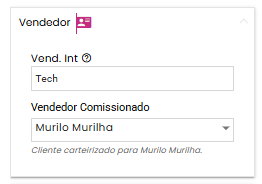

Seção expansível que exibe informações sobre comissionamento.

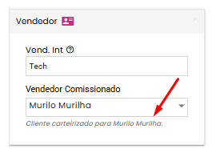

| Campo | Tipo | Descrição |
|-------|------|-----------|
| Vend. Int | Texto (readonly) | Vendedor interno (ex: Tech Lead) |
| Vendedor Comissionado | Select | Vendedor que receberá comissão pela venda |

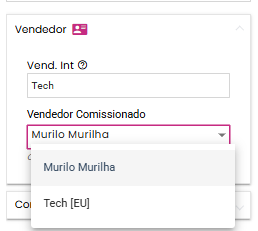

:::info Cliente Carteirizado
Quando o cliente é carteirizado, o sistema exibe automaticamente a mensagem **"Cliente carteirizado para [nome do vendedor]"**.
:::

### Seção Contatos

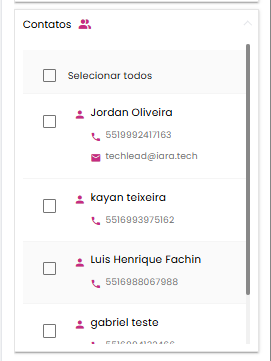

Seção expansível para gerenciar contatos que receberão o orçamento. Lista os contatos do cliente que poderão receber o PDF e Excel do orçamento quando compartilhado.

---

## Painel Lateral - Aba "Produto"

Quando um produto é selecionado na listagem central, a aba "Produto" é ativada automaticamente exibindo os detalhes do item.

### Informações do Produto

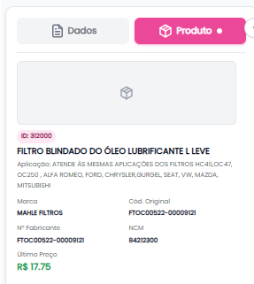

| Seção | Campos | Descrição |
|-------|--------|-----------|
| Imagem | Imagem do Produto | Foto ou placeholder do produto |
| Identificação | ID, Descrição completa, Aplicação | Dados básicos do produto |
| Fabricante | Marca, Cód. Original, Nº Fabricante, NCM | Informações do fabricante |
| Preço | Último Preço | Último preço praticado (ex: R$ 17.75) |

### Card de Estoque

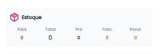

Exibe resumo consolidado do estoque:

| Campo | Descrição |
|-------|-----------|
| Filial Selecionada | Quantidade de item na unidade selecionada |
| Total | Estoque total disponível |
| Pré | Pré-estoque |
| Trân. | Em trânsito |
| Pend. | Pendente de recebimento |

### Card Fiscal

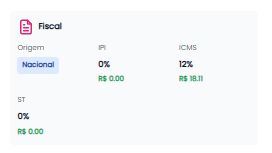

Informações tributárias do produto:

| Campo | Descrição |
|-------|-----------|
| Origem | Origem fiscal (Nacional, Importado, etc.) |
| IPI | Alíquota de IPI (%) e valor |
| ICMS | Alíquota de ICMS (%) e valor |
| ST | Substituição Tributária (%) e valor |

### Card Info Cliente

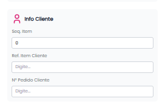

Campos para informações específicas do cliente sobre o item:

| Campo | Tipo | Descrição |
|-------|------|-----------|
| Seq. Item | Número | Sequência do item no pedido do cliente |
| Ref. Item Cliente | Texto | Código/referência do cliente para o item |
| Nº Pedido Cliente | Texto | Número do pedido de compra do cliente |

### Botão de Ação

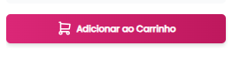

**Adicionar ao Carrinho**: Botão principal rosa que adiciona o produto ao carrinho com as configurações informadas.

---

## Área Central - Busca de Produtos

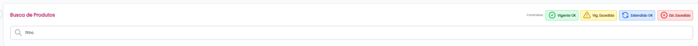

### Campo de Busca

| Elemento | Descrição |
|----------|-----------|
| Ícone | Lupa indicando campo de pesquisa |
| Comportamento | Busca em tempo real ao digitar |

### Filtros de Contrato (Em Breve)

Localizados no canto superior direito da área de busca:

| Filtro | Cor | Descrição |
|--------|-----|-----------|
| Vigente OK | Verde | Produtos com contrato vigente |
| Vig. Excedido | Amarelo | Contratos com vigência excedida |
| Estendido OK | Verde claro | Contratos estendidos válidos |
| Est. Excedido | Rosa | Contratos estendidos excedidos |

### Tabela de Produtos

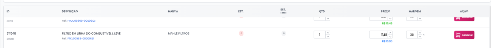

#### Colunas da Listagem

| Coluna | Descrição | Interação |
|--------|-----------|-----------|
| ID | Código do produto + código secundário | - |
| Descrição | Nome do produto + Referência clicável | Link abre detalhes |
| Marca | Fabricante do produto | - |
| EST. | Estoque na filial selecionada | - |
| EST. Total | Estoque total (todas filiais) | Clicável - abre modal de estoque |
| QTD | Quantidade a adicionar | Input numérico com setas |
| Preço | Preço unitário | Input editável |
| Margem | Margem de lucro (%) | Input editável |
| Ação | Botão "Adicionar" | Adiciona ao carrinho |

#### Navegação por Teclado

| Tecla | Ação |
|-------|------|
| Seta para cima | Move seleção para o item anterior |
| Seta para baixo | Move seleção para o próximo item |

#### Indicadores Visuais de Estoque

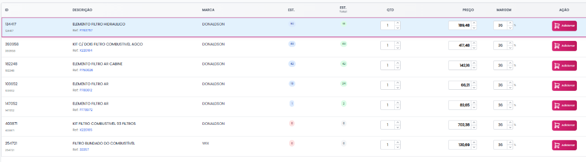

| Cor | Significado |
|-----|-------------|
| Azul | Estoque disponível na unidade selecionada |
| Verde | Estoque disponível em outras unidades |
| Vermelho | Sem estoque |
| Número em badge | Quantidade disponível |

### Paginação

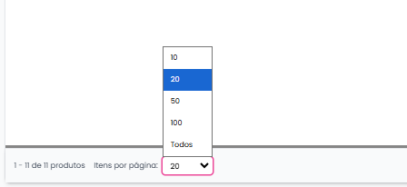

Localizada no rodapé da listagem:

- **Contador:** "1 - 20 de 25065 produtos"
- **Itens por página:** Select com opções (20, 50, 100)
- **Navegação:** Botões numéricos (1, 2, 3, 4, 5...) e setas

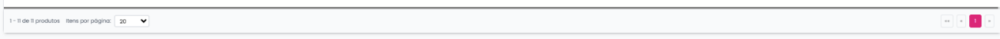

---

## Modal de Estoque por Filial

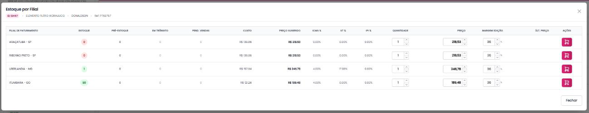

Acionado ao clicar na coluna **"EST. Total"** de um produto.

### Cabeçalho do Modal

Exibe identificação completa do produto:

- ID do produto
- Descrição
- Marca
- Referência

### Tabela de Estoque

| Coluna | Descrição |
|--------|-----------|
| Filial de Faturamento | Nome da filial (ex: ARAÇATUBA - SP) |
| Estoque | Quantidade em estoque |
| Pré-Estoque | Quantidade reservada |
| Em Trânsito | Quantidade em transporte |
| Pend. Vendas | Pendente para vendas |
| Custo | Custo do produto na filial |
| Preço Sugerido | Preço sugerido de venda |
| ICMS % | Alíquota de ICMS |
| ST % | Alíquota de ST |
| IPI % | Alíquota de IPI |
| Quantidade | Input para definir quantidade |
| Preço | Input para definir preço de venda |
| Margem Edição | Input para ajustar margem |
| Últ. Preço | Último preço praticado |
| Ações | Botão para adicionar da filial específica |

### Indicadores de Estoque

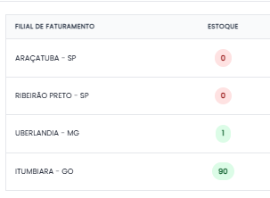

| Indicador | Cor | Significado |
|-----------|-----|-------------|
| Badge verde | Verde | Com estoque |
| Badge vermelho | Vermelho (0) | Sem estoque |

### Ações do Modal

- **Botão Carrinho (por linha):** Adiciona o produto da filial específica ao carrinho
- **Botão Fechar:** Fecha o modal sem ação

---

## Modal "Produto Já Incluído"

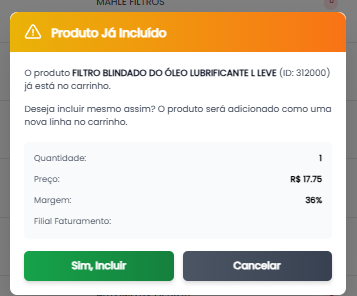

Exibido quando o usuário tenta adicionar um produto que já está no carrinho.

### Informações do Modal

| Campo | Descrição |
|-------|-----------|
| Título | "Produto Já Incluído" (com ícone de alerta) |
| Mensagem | Informa o nome e ID do produto já existente |
| Quantidade | Quantidade que será adicionada |
| Preço | Preço unitário |
| Margem | Margem aplicada |
| Filial Faturamento | Filial |

### Opções de Ação

| Botão | Cor | Ação |
|-------|-----|------|
| Sim, Incluir | Azul | Adiciona como nova linha no carrinho |
| Cancelar | Cinza | Cancela a operação |

:::tip Comportamento
Ao confirmar, o produto é adicionado como uma **nova linha separada** no carrinho, permitindo múltiplas entradas do mesmo produto com configurações diferentes.
:::

---

## Carrinho de Compras

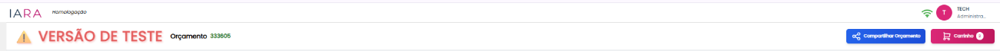

### Acesso ao Carrinho

- **Botão:** "Carrinho" no canto superior direito
- **Badge:** Exibe quantidade de itens (ex: "2")
- **Cor:** Rosa/Pink

### Cabeçalho do Carrinho

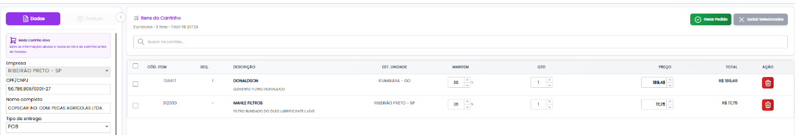

| Elemento | Descrição |
|----------|-----------|
| Título | "Itens do Carrinho" |
| Resumo | "[X] produto(s) - [Y] Item(s) - Total: R$ [valor]" |
| Campo de busca | "Buscar no carrinho..." |

### Tabela do Carrinho

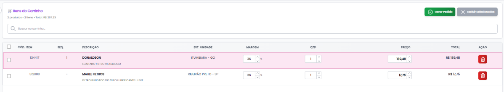

| Coluna | Tipo | Descrição |
|--------|------|-----------|
| Checkbox | Seleção | Selecionar item para ações em lote |
| Cód. Item | Texto | Código do produto |
| Seq. | Número | Sequência do item |
| Descrição | Texto | Nome do produto + Marca |
| Est. Unidade | Texto | Filial de faturamento |
| Margem | Percentual | Margem aplicada |
| QTD | Input numérico | Quantidade (editável) |
| Preço | Input moeda | Preço unitário (editável) |
| Total | Moeda (readonly) | Valor total da linha |
| Ação | Botão | Excluir item |

### Painel Lateral do Carrinho (Aba Produto)

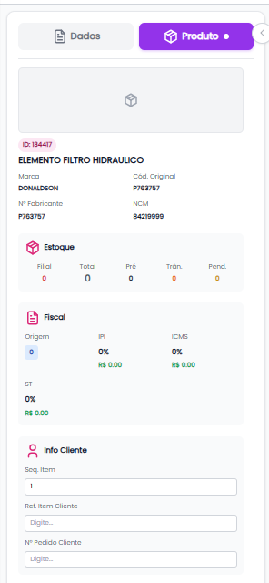

Quando um item do carrinho é selecionado, exibe no painel esquerdo:

- Imagem do produto (placeholder se não houver)
- ID e descrição
- Marca e Código Original
- Nº Fabricante e NCM
- Card de Estoque
- Card Fiscal (Origem, IPI, ICMS, ST)

### Ações do Carrinho

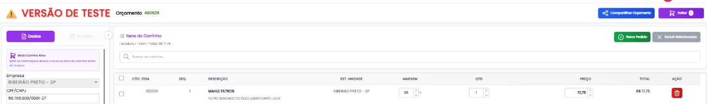

| Botão | Cor | Ação |
|-------|-----|------|
| Gerar Pedido | Verde | Abre modal de confirmação para gerar pedido |
| Excluir Selecionados | Cinza/Rosa | Remove itens selecionados (requer motivo) |
| Voltar | Cinza | Retorna à tela de busca |
| Compartilhar Orçamento | Rosa | Compartilha o orçamento |

---

## Modal de Confirmação - Gerar Pedido

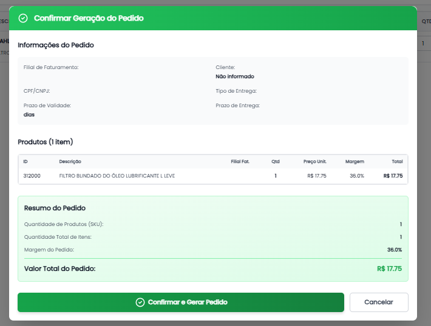

Exibido ao clicar em **"Gerar Pedido"**.

### Cabeçalho

- **Título:** "Confirmar Geração do Pedido"
- **Cor:** Verde (indicando ação positiva)

### Seção "Informações do Pedido"

| Campo | Descrição |
|-------|-----------|
| Filial de Faturamento | Filial que emitirá o pedido |
| Cliente | Nome do cliente (ou "Não informado") |
| CPF/CNPJ | Documento do cliente |
| Tipo de Entrega | Modalidade de frete |
| Prazo de Validade | Validade em dias |
| Prazo de Entrega | Prazo de entrega em dias |

### Seção "Produtos"

Tabela resumida dos itens:

| Coluna | Descrição |
|--------|-----------|
| ID | Código do produto |
| Descrição | Nome do produto |
| Filial Fat. | Filial de faturamento |
| Qtd | Quantidade |
| Preço Unit. | Preço unitário |
| Margem | Margem aplicada |
| Total | Valor total do item |

### Seção "Resumo do Pedido"

| Campo | Descrição |
|-------|-----------|
| Quantidade de Produtos (SKU) | Total de SKUs diferentes |
| Quantidade Total de Itens | Soma das quantidades |
| Margem do Pedido | Margem média ponderada |
| Valor Total do Pedido | Valor total (destacado em verde) |

### Botões de Ação

| Botão | Cor | Ação |
|-------|-----|------|
| Confirmar e Gerar Pedido | Verde | Confirma e gera o pedido no sistema |
| Cancelar | Cinza | Fecha o modal sem gerar |

---

## Geração de Pedido Parcial

O sistema permite gerar pedidos com apenas alguns itens do carrinho, oferecendo flexibilidade para situações onde o cliente aprova apenas parte do orçamento.

### Como Funciona

1. Acessar o Carrinho
2. Selecionar via checkbox **APENAS** os itens aprovados pelo cliente
3. Clicar em **"Gerar Pedido"**
4. Modal exibe somente os itens selecionados
5. Confirmar geração do pedido parcial

### Comportamento dos Itens

| Situação do Item | O que acontece |
|------------------|----------------|
| Selecionado (checkbox marcado) | Incluído no pedido gerado |
| Não selecionado (checkbox vazio) | Permanece no carrinho do orçamento |

### Cenário de Uso

**Cenário 1 - Aprovação Parcial do Cliente**

Cliente aprovou apenas 3 de 10 itens do orçamento. O vendedor seleciona os 3 itens aprovados e gera o pedido. Os outros 7 itens permanecem no orçamento para negociação futura.

### Validações

| Validação | Comportamento |
|-----------|---------------|
| Nenhum item selecionado | Automaticamente exibe no resumo todos os itens como selecionados |

### Após Gerar o Pedido Parcial

| Ação | Resultado |
|------|-----------|
| Pedido gerado | Sistema cria pedido apenas com itens selecionados |
| Itens do pedido | Removidos do carrinho do orçamento |
| Itens restantes | Permanecem no carrinho para futuras ações |
| Orçamento | Continua disponível para novas operações |
| Notificação | Toast de sucesso com número do pedido gerado |

### Exemplo Prático

**CARRINHO DO ORÇAMENTO (5 itens - Total R$ 500,00)**

| Sel. | Produto | Valor | Status |
|------|---------|-------|--------|
| ✅ | Filtro de Óleo | R$ 50,00 | Selecionado |
| ✅ | Filtro de Ar | R$ 80,00 | Selecionado |
| ⬜ | Correia Dentada | R$ 120,00 | NÃO selecionado |
| ⬜ | Bomba d'Água | R$ 150,00 | NÃO selecionado |
| ✅ | Filtro de Combustível | R$ 100,00 | Selecionado |

**Ao clicar em "GERAR PEDIDO":**

O modal de confirmação exibirá apenas 3 itens com Total de R$ 230,00

**Após confirmar:**

- Pedido #12345 gerado com 3 itens (R$ 230,00)
- Carrinho do orçamento mantém 2 itens restantes (R$ 270,00): Correia Dentada e Bomba d'Água

:::info Vínculo Mantido
O sistema mantém vínculo entre orçamento e pedidos gerados.
:::

---

## Modal de Compartilhamento

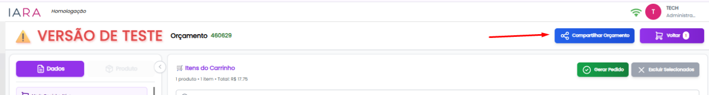

Acionado pelo botão **"Compartilhar Orçamento"** no header do carrinho.

### Cabeçalho do Modal

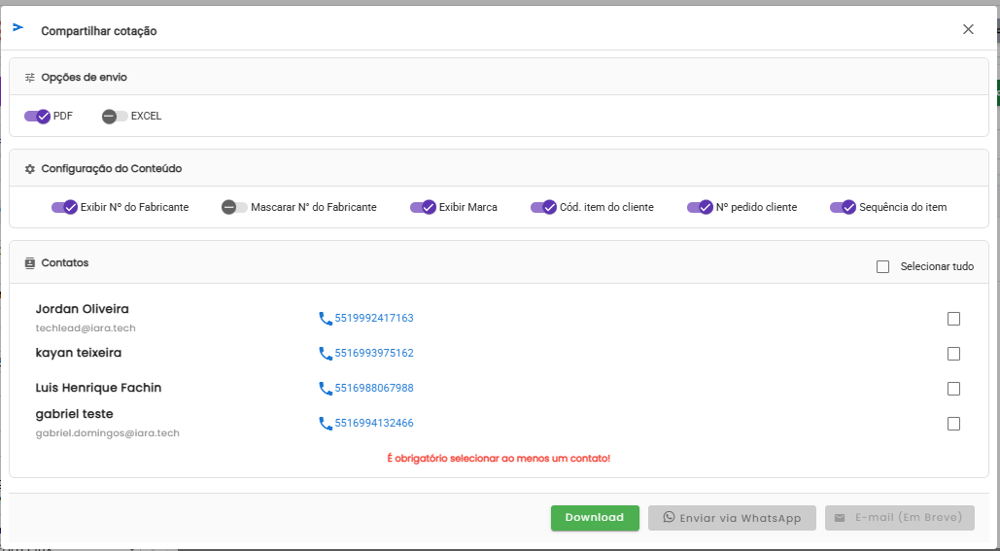

- **Título:** "Compartilhar cotação"
- **Ícone:** Seta de envio
- **Fechar:** Botão "X" no canto superior direito

### Opções de Envio

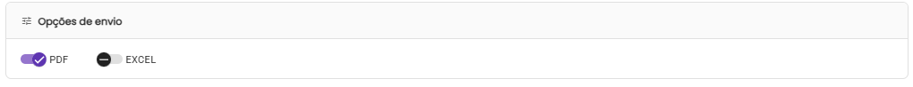

Toggles para selecionar o formato do arquivo:

| Opção | Estado Padrão | Descrição |
|-------|---------------|-----------|
| PDF | Selecionado (roxo) | Gera arquivo PDF do orçamento |
| EXCEL | Não Selecionado (cinza) | Gera arquivo Excel do orçamento |

:::tip Múltiplos Formatos
Pode selecionar um ou ambos os formatos simultaneamente.
:::

### Configuração do Conteúdo

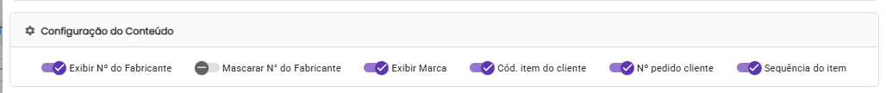

Toggles para personalizar quais informações serão exibidas no documento:

| Opção | Estado Padrão | Descrição |
|-------|---------------|-----------|
| Exibir Nº do Fabricante | Ativo | Mostra o número do fabricante no documento |
| Mascarar Nº do Fabricante | Inativo | Lógica de alteração de caracteres para o Nº do Fabricante |
| Exibir Marca | Ativo | Mostra a marca/fabricante do produto |
| Cód. item do cliente | Ativo | Mostra o código de referência do cliente |
| Nº pedido cliente | Ativo | Mostra o número do pedido do cliente |
| Sequência do item | Ativo | Mostra a sequência/ordem dos itens |

### Seção Contatos

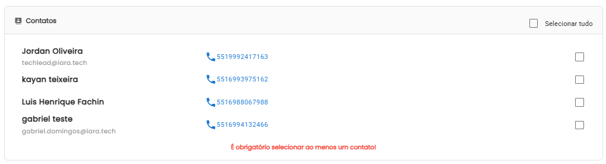

Lista os contatos do cliente disponíveis para envio.

#### Cabeçalho da Seção

- **Título:** "Contatos"
- **Checkbox:** "Selecionar tudo" (seleciona todos os contatos)

#### Informações por Contato

| Campo | Descrição |
|-------|-----------|
| Nome | Nome do contato (ex: Jordan Oliveira) |
| E-mail | E-mail do contato (ex: techlead@iara.tech) |
| Telefone | Link clicável com ícone de telefone (formato: 5519992417163) |
| Checkbox | Seleção individual do contato |

#### Indicadores Visuais

| Estado | Indicador |
|--------|-----------|
| Selecionado | Checkbox amarelo com check |
| Não selecionado | Checkbox vazio |

### Botões de Ação

| Botão | Cor | Estado | Ação |
|-------|-----|--------|------|
| Download | Azul | Sempre ativo | Baixa o arquivo no formato selecionado |
| Enviar via WhatsApp | Verde | Ativo quando há contato selecionado | Abre WhatsApp com o documento |
| E-mail | Cinza | Em Breve (desabilitado) | Funcionalidade futura |

### Fluxo de Compartilhamento

1. Clicar em **"Compartilhar Orçamento"**
2. Selecionar formato (PDF e/ou Excel)
3. Configurar quais informações exibir no documento
4. Selecionar contato(s) destinatário(s)
5. Escolher método de envio:
   - **Download:** Baixa arquivo localmente
   - **WhatsApp:** Envia na conversa com documento anexo
   - **E-mail:** (Em breve)

---

## Ações Principais (Header)

### Compartilhar Orçamento

- **Botão:** "Compartilhar Orçamento"
- **Cor:** Rosa
- **Função:** Abre o modal de compartilhamento

### Carrinho

- **Botão:** "Carrinho" com badge de quantidade
- **Cor:** Rosa
- **Função:** Acessa a tela do carrinho de compras

### Voltar

- **Botão:** "Voltar"
- **Cor:** Cinza
- **Função:** Retorna à listagem de orçamentos (disponível no carrinho)

### Excluir Selecionados

- **Botão:** "Excluir Selecionados"
- **Cor:** Vermelha
- **Função:** Abrir Modal de Registro de Venda Perdida

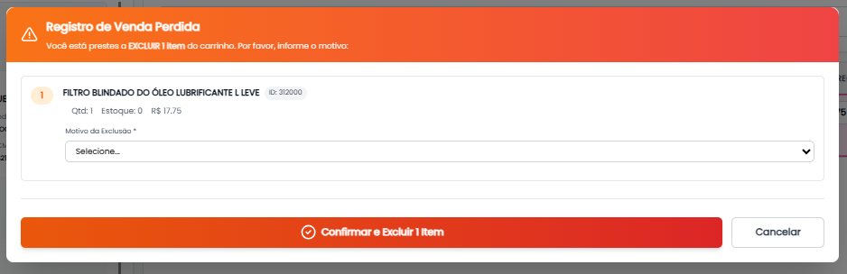

---

## Dicas e Boas Práticas

- Preencha todos os dados comerciais antes de adicionar produtos ao carrinho
- Use a navegação por teclado (setas) para agilizar a seleção de produtos
- Configure as opções de exibição antes de compartilhar o orçamento
- Utilize o pedido parcial para aprovações em etapas

## Perguntas Frequentes

**P: Posso adicionar o mesmo produto mais de uma vez?**

R: Sim. Ao tentar adicionar um produto já existente, o sistema exibe um modal perguntando se deseja incluir como nova linha, permitindo configurações diferentes.

**P: O que acontece com os itens não selecionados ao gerar um pedido parcial?**

R: Eles permanecem no carrinho do orçamento para futuras negociações ou geração de novos pedidos.

**P: Como sei se um cliente é carteirizado?**

R: O sistema exibe automaticamente a mensagem "Cliente carteirizado para [nome do vendedor]" na seção de Vendedor.

**P: Posso enviar o orçamento por e-mail?**

R: A funcionalidade de envio por e-mail está em desenvolvimento (Em Breve). Atualmente, utilize Download ou WhatsApp.

**P: Como verificar o estoque em outras filiais?**

R: Clique na coluna "EST. Total" do produto desejado para abrir o modal com estoque detalhado de todas as filiais.

**P: É possível editar quantidade e preço diretamente no carrinho?**

R: Sim, os campos de QTD e Preço são editáveis diretamente na tabela do carrinho.
