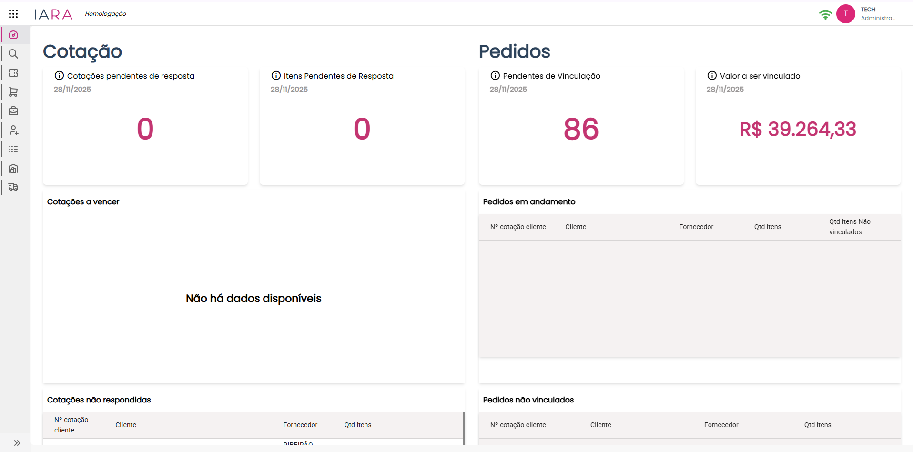

# Dashboard

Documentação detalhada sobre o **Dashboard**.

## Objetivo

O Dashboard de Cotações é a tela principal de monitoramento do módulo, oferecendo uma visão consolidada de todas as cotações e pedidos. Permite acompanhar o status das cotações, identificar pendências e analisar indicadores de desempenho.

## Acesso à Tela

**Caminho:** Menu lateral → Dashboard

## Estrutura da Tela

A tela é organizada em seções que agrupam informações por status e tipo:

| Seção | Função |
|-------|--------|
| Cards de Resumo | Indicadores rápidos de pendências |
| Cotações não respondidas | Lista de cotações aguardando resposta |
| Cotações respondidas | Lista de cotações já respondidas |
| Cotações em andamento | Cotações com resposta parcial em progresso |
| Cotações parcialmente respondidas | Cotações com alguns itens respondidos |
| Cards de Pedidos | Indicadores de pedidos pendentes |
| Pedidos em andamento | Pedidos sendo processados |
| Pedidos não vinculados | Pedidos aguardando vinculação |
| Pedidos vinculados | Pedidos já vinculados |
| Indicadores de Análise | Marcas, itens cotados e estatísticas |

---

## Cards de Resumo - Cotações

Localizados no topo da tela, exibem indicadores rápidos:

### Cotações pendentes de resposta

| Campo | Descrição |
|-------|-----------|
| Data | Data de referência (ex: 28/11/2025) |
| Valor | Quantidade de cotações pendentes |

### Itens Pendentes de Resposta

| Campo | Descrição |
|-------|-----------|
| Data | Data de referência |
| Valor | Quantidade total de itens aguardando resposta |

### Cotações a vencer

Exibe cotações próximas do prazo de validade. Quando não há dados, exibe "Não há dados disponíveis".

---

## Cotações não respondidas

Lista de cotações que ainda não receberam nenhuma resposta.

### Colunas da Tabela

| Coluna | Descrição |
|--------|-----------|
| Nº cotação cliente | Número/identificador da cotação do cliente |
| Cliente | Nome do cliente (ex: USINA ADECOAGRO - MS) |
| Fornecedor | Filial responsável (ex: RIBEIRÃO PRETO - SP) |
| Qtd itens | Quantidade de itens na cotação |

### Paginação

- **Itens por página:** Seletor com opção padrão de 10 itens
- **Navegação:** Exibe "1 – 10 of X" com controles de página

---

## Cotações respondidas

Lista de cotações que já foram completamente respondidas.

### Colunas da Tabela

| Coluna | Descrição |
|--------|-----------|
| Nº cotação cliente | Número/identificador da cotação |
| Cliente | Nome do cliente |
| Fornecedor | Filial responsável |
| Qtd itens | Quantidade de itens respondidos |

### Paginação

- **Itens por página:** Seletor com opção padrão de 10 itens
- **Navegação:** Exibe "1 – 10 of X" com controles de página

---

## Cotações em andamento

Cotações que estão sendo respondidas, com progresso parcial.

### Colunas da Tabela

| Coluna | Descrição |
|--------|-----------|
| Nº cotação cliente | Número/identificador da cotação |
| Cliente | Nome do cliente |
| Fornecedor | Filial responsável |
| Qtd itens | Quantidade total de itens |
| Qtd Itens Não respondidos | Itens ainda pendentes de resposta |
| Itens respondidos | Itens já respondidos |

:::tip Acompanhamento de Progresso
Esta seção permite visualizar rapidamente o andamento de cada cotação, comparando itens respondidos versus pendentes.
:::

### Paginação

- **Itens por página:** Seletor com opção padrão de 10 itens
- **Navegação:** Exibe "1 – X of X" com controles de página

---

## Cotações parcialmente respondidas

Cotações onde apenas parte dos itens foi respondida, exibindo proporção de conclusão.

### Colunas da Tabela

| Coluna | Descrição |
|--------|-----------|
| Nº cotação cliente | Número/identificador da cotação |
| Cliente | Nome do cliente |
| Fornecedor | Filial responsável |
| Qtd itens | Proporção respondidos/total (ex: 345 / 349) |

:::info Formato da Proporção
A coluna "Qtd itens" exibe no formato **[respondidos] / [total]**, facilitando a visualização do progresso.
:::

### Paginação

- **Itens por página:** Seletor com opção padrão de 10 itens
- **Navegação:** Exibe "1 – X of X" com controles de página

---

## Cards de Resumo - Pedidos

Indicadores rápidos sobre pedidos:

### Pendentes de Vinculação

| Campo | Descrição |
|-------|-----------|
| Data | Data de referência (ex: 28/11/2025) |
| Valor | Quantidade de pedidos pendentes de vinculação |

### Valor a ser vinculado

| Campo | Descrição |
|-------|-----------|
| Data | Data de referência |
| Valor | Valor monetário total pendente (ex: R$ 39.264,33) |

---

## Pedidos em andamento

Lista de pedidos que estão sendo processados.

### Colunas da Tabela

| Coluna | Descrição |
|--------|-----------|
| Nº cotação cliente | Número/identificador do pedido |
| Cliente | Nome do cliente |
| Fornecedor | Filial responsável |
| Qtd itens | Quantidade de itens no pedido |
| Qtd Itens Não vinculados | Itens pendentes de vinculação |

---

## Pedidos não vinculados

Lista de pedidos aguardando vinculação com cotações ou documentos.

### Colunas da Tabela

| Coluna | Descrição |
|--------|-----------|
| Nº cotação cliente | Número/identificador do pedido |
| Cliente | Nome do cliente |
| Fornecedor | Filial responsável |
| Qtd itens | Quantidade de itens |

---

## Pedidos vinculados

Lista de pedidos já vinculados e processados.

### Colunas da Tabela

| Coluna | Descrição |
|--------|-----------|
| Nº cotação cliente | Número/identificador do pedido |
| Cliente | Nome do cliente |
| Fornecedor | Filial responsável |
| Qtd itens | Quantidade de itens vinculados |

### Paginação

- **Itens por página:** Seletor com opção padrão de 10 itens
- **Navegação:** Exibe "1 – 10 of X" com controles de página

---

## Indicadores de Análise

Seções de análise para tomada de decisão estratégica.

### Marcas mais vinculadas

Exibe ranking das marcas/fabricantes mais frequentes nas vinculações. Quando não há dados, exibe "Não há dados disponíveis".

### Itens mais cotados sem estoque

Lista de itens frequentemente solicitados mas sem disponibilidade em estoque.

| Coluna | Descrição |
|--------|-----------|
| Quantidade | Número de vezes que o item foi cotado |
| Descrição | Nome/descrição do item |

**Exemplos de itens:**
- PARAFUSO RODA
- CUBO ARO 22
- CAIXA SATELITE
- PILOTO
- EIXO ENTALHAO

:::warning Oportunidade de Estoque
Esta lista indica potenciais oportunidades de compra para atender demanda recorrente.
:::

### Itens mais cotados não trabalhamos

Lista de itens solicitados pelos clientes que não fazem parte do catálogo atual.

| Coluna | Descrição |
|--------|-----------|
| Quantidade | Número de vezes que o item foi solicitado |
| Descrição | Nome/descrição do item com marca e referência |

:::info Análise de Portfólio
Esta seção ajuda a identificar oportunidades de expansão do catálogo de produtos.
:::

---

## Dicas e Boas Práticas

- Monitore diariamente os cards de resumo para identificar pendências
- Priorize cotações próximas do vencimento na seção "Cotações a vencer"
- Use a lista de "Itens mais cotados sem estoque" para planejamento de compras
- Acompanhe o progresso das cotações em andamento para garantir prazos
- Analise os "Itens não trabalhamos" para decisões de expansão de portfólio

## Perguntas Frequentes

**P: O que significa uma cotação "parcialmente respondida"?**

R: É uma cotação onde apenas alguns itens receberam resposta. A coluna "Qtd itens" mostra a proporção (ex: 345/349 significa 345 itens respondidos de 349 totais).

**P: Qual a diferença entre "em andamento" e "parcialmente respondida"?**

R: "Em andamento" mostra cotações sendo trabalhadas ativamente com detalhes de itens respondidos e não respondidos. "Parcialmente respondida" é um resumo de cotações com resposta incompleta.

