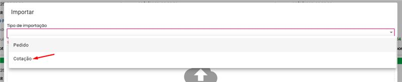
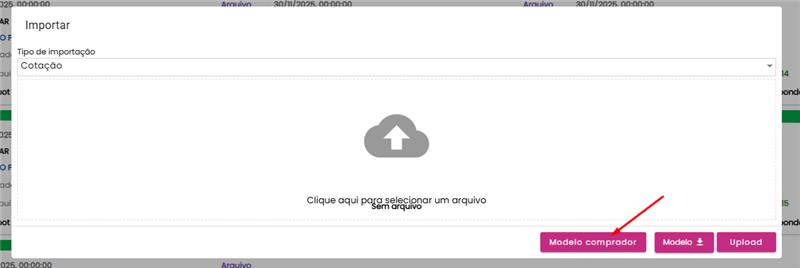
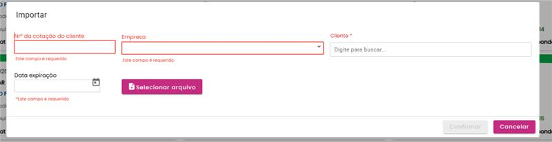
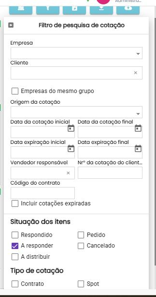
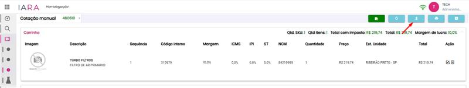
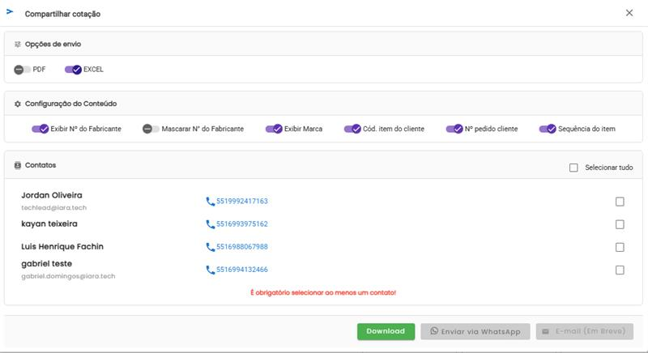

<!-- truncate -->

# Atualização 25/11/2025

## 📚 Sumário

- [📤 Importação de PDF e Planilha](#-importação-de-pdf-e-planilha)
- [📥 Download/Envio de Orçamento em Excel](#-downloadenvio-de-orçamento-em-excel)
- [✨ Benefícios](#-benefícios)

---

## 📤 Importação de PDF e Planilha

Permite fazer upload de planilhas em diversos formatos para responder cotações de forma ágil.

### Formatos Suportados

| Formato | Extensão |
|---------|----------|
| PDF | `.pdf` |
| Excel 97-2003 | `.xls` |
| Excel | `.xlsx` |
| Excel Binário | `.xlsb` |
| OpenDocument | `.ods` |

### Passo a Passo

**1. Acesse a área de resposta**
- Entre em **Responder Cotação**

**2. Inicie a importação**

- Clique em **Importar Arquivo**
- Tipo de Importação: **Cotação**

- Clique em **Modelo Comprador**

**3. Preencha as informações obrigatórias**

| Campo | Obrigatório |
|-------|-------------|
| Nº da Cotação do Cliente | ✅ Sim |
| Empresa | ✅ Sim |
| Cliente | ✅ Sim |
| Data de Expiração | ✅ Sim |

**4. Selecione o arquivo**
- Escolha o arquivo da planilha no seu dispositivo
- Confirme o upload

**5. Acesse a cotação importada**
- Entre em **Responder Cotação**
- Utilize o **Filtro de pesquisa** para localizar a cotação importada
- Pesquise por: Empresa, Cliente, Data ou Nº da cotação do cliente

---

## 📥 Download/Envio de Orçamento em Excel

Permite exportar orçamentos em formato Excel com opções de compartilhamento flexíveis.

### Passo a Passo

**1. Prepare o orçamento**
- Entre em **Cotação Manual**
- Insira os itens desejados no carrinho

**2. Acesse as opções de download**

- Clique em **Download**
- Selecione a opção **EXCEL**

**3. Configure a exportação**

*Opções de Formato:*
- 📄 PDF
- 📊 EXCEL

*Configuração do Conteúdo:*

| Opção | Descrição |
|-------|-----------|
| ✅ Exibir Nº do Fabricante | Mostra o número original do fabricante |
| ✅ Mascarar Nº do Fabricante | Oculta parcialmente o número |
| ✅ Exibir Marca | Exibe a marca do produto |
| ✅ Cód. item do cliente | Inclui código do cliente |
| ✅ Nº pedido cliente | Adiciona número do pedido |
| ✅ Sequência do item | Mostra a sequência dos itens |

**4. Escolha os destinatários**

Selecione um ou mais contatos da lista.

:::warning Atenção
É obrigatório selecionar ao menos um contato para **Enviar por WhatsApp**.
:::

**5. Finalize**

Escolha uma das opções:

| Ação | Descrição |
|------|-----------|
| 💾 Download | Baixar arquivo localmente |
| 📱 WhatsApp | Compartilhar direto pelo WhatsApp |
| 📧 E-mail | *(Em Breve)* Funcionalidade em desenvolvimento |

---

## ✨ Benefícios

- ⚡ **Agilidade:** Importação e exportação rápida de dados
- 🎯 **Flexibilidade:** Múltiplos formatos suportados
- 🔄 **Integração:** Compartilhamento direto via WhatsApp
- 📊 **Personalização:** Controle sobre informações exibidas no documento